# ihale-takip

Kamu ihale süreçlerini baştan sona izleyen REST API ve web arayüzü: taslaktan sözleşmeye kadar durum akışı, tutara göre onay kademeleri, iş günü ve resmi tatil bilen süre hesabı, rol ve birim bazlı yetki, kullanıcı yönetimi ve değiştirilemez denetim kaydı.

**Java 21 · Spring Boot 3 · Oracle · Flyway · Spring Security (JWT + Active Directory) · JUnit 5 · OpenAPI**

[](https://github.com/emircankilicaslan/ihale-takip/actions/workflows/ci.yml)
[](LICENSE)

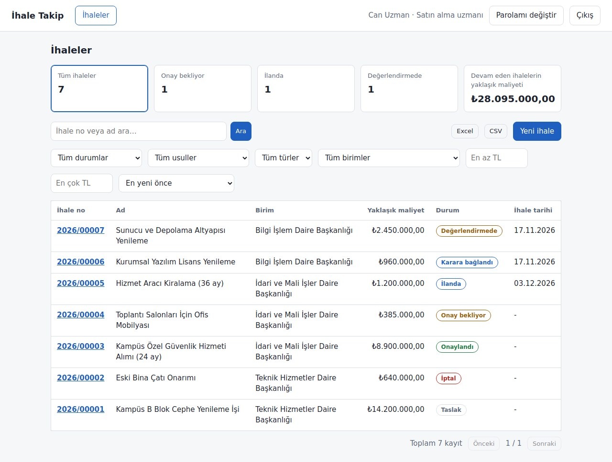

> **Doğrulama:** Her push'ta GitHub Actions, Oracle Free servis konteynerine karşı **248 test** (birim ve uçtan uca; parametrik testlerin her senaryosu ayrı sayılır) çalıştırır.
>
> **Mevzuat uyarısı:** Bu bir portfolyo/demo projesidir, hukuki danışmanlık değildir. Onay sınırları, ilan süreleri ve itiraz süresi **örnek değerlerdir** ve `application.yml` içinden ayarlanır; gerçek bir kurumda 4734 sayılı Kanun ve ilgili mevzuat ile doğrulanmalıdır. Kazanan seçimi "en düşük fiyat" olarak sadeleştirilmiştir.

## Neden bu proje

Kamu kurumlarında bilişim işleri çoğunlukla Java/.NET, Oracle ve kurumsal dizin (Active Directory) üzerinde yürür. Bu proje o ortama uyumlu bir iş uygulamasını gösterir: kimin neyi ne zaman yaptığı kayıt altındadır, yetkiler kuralla sınırlıdır, süreler takvime göre hesaplanır.

## Özellikler

- **İhale yaşam döngüsü:** taslak → onay → ilan → teklifler → değerlendirme → karar → sözleşme (her aşamadan iptal)
- **Onay kademeleri:** yaklaşık maliyete göre 1/2/3. kademe; birim müdürü, daire başkanı, üst yönetici
- **Süre hesabı:** ilan süresi ve itiraz süresi takvim günüyle, hafta sonu ve resmi tatilleri atlayarak hesaplanır
- **Teklif kuralları:** aşırı düşük teklif işareti ve komisyon kararı, yaklaşık maliyeti aşan teklifin elenmesi, en düşük uygun teklif
- **Yetki:** 8 rol, birim bazlı görünürlük, görev ayrılığı, kademe kontrolü
- **Kullanıcı yönetimi:** yönetici kullanıcı ekler, rol ve birim değiştirir, pasife alır; parola politikası; art arda hatalı girişte geçici kilit; parola değiştirme
- **Değiştirilemez denetim kaydı:** veritabanı tetikleyicisiyle korunur; giriş denemeleri dahil her olay yazılır
- **Dışa aktarma:** ihale listesi ve denetim kaydı Excel (.xlsx) veya CSV olarak; formül enjeksiyonuna karşı korumalı
- **Swagger arayüzü** (`/swagger`) ve OpenAPI belgesi (`/v3/api-docs`)
- **Kimlik:** yerel kullanıcı + BCrypt veya kurumun Active Directory'si

## Web arayüzü

Uygulama açıldığında kök adres (`/`) bir çalışma paneli sunar. Derleme adımı ve dış kütüphane yoktur: dosyalar `src/main/resources/static` altındadır (sade HTML, CSS ve JavaScript).

| Rol | Gördükleri ve yapabildikleri |
|---|---|
| **Birim sorumlusu / müdürü** | Yalnızca kendi birimindeki ihaleler; oluşturma, onaya gönderme; müdür kademesi yettiği ölçüde onaylama |
| **Daire başkanı / üst yönetici** | Tüm ihaleler; onaylama, geri çevirme, iptal |
| **Satın alma uzmanı** | İlan etme, teklif girme, sözleşmeyi işleme |
| **Komisyon üyesi** | Teklifleri değerlendirme, ret ve aşırı düşük kararı, kazananı seçme |
| **Denetçi** | Her şeyi okuma, denetim kaydı; hiçbir şeyi değiştiremez |
| **Yönetici** | Kullanıcı yönetimi, resmi tatiller, denetim kaydı |


- **Genel bakış:** durum kartları (tıklayınca ilgili listeyi açar), devam eden ihalelerin toplam yaklaşık maliyeti; Excel ve CSV dışa aktarma
- **Rol ve duruma göre işlemler:** onayla / geri çevir, ilan et, teklif ekle, kazanan seç, iptal. Yetki kararını her zaman sunucu verir; arayüz yalnızca uygun düğmeleri gösterir ve sunucunun hata mesajını olduğu gibi iletir. İtiraz süresi dolmadan sözleşme düğmesi pasif kalır

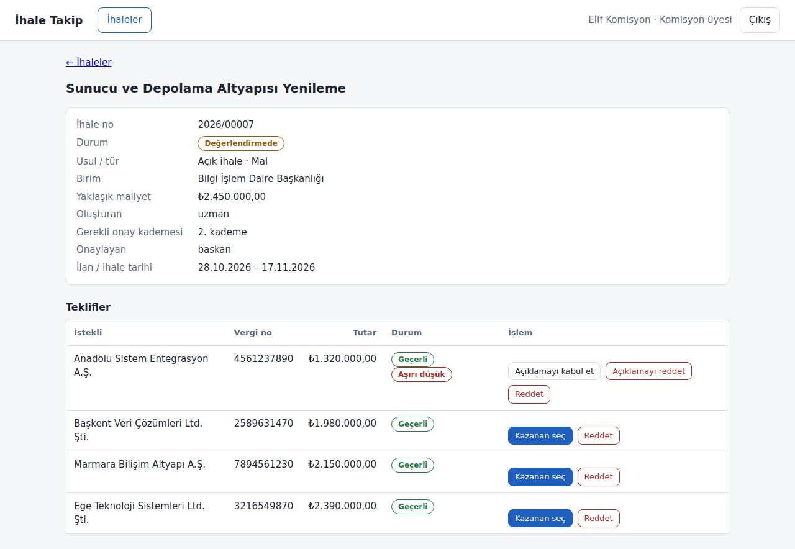

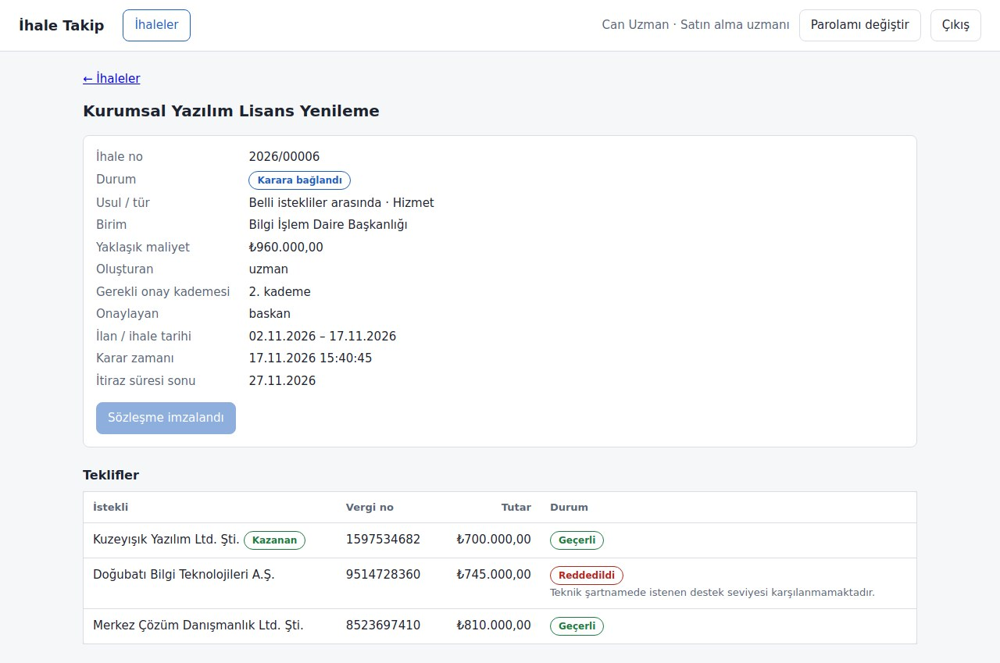

| Onay bekleyen ihale (daire başkanı) | Yeni ihale |
|---|---|
| 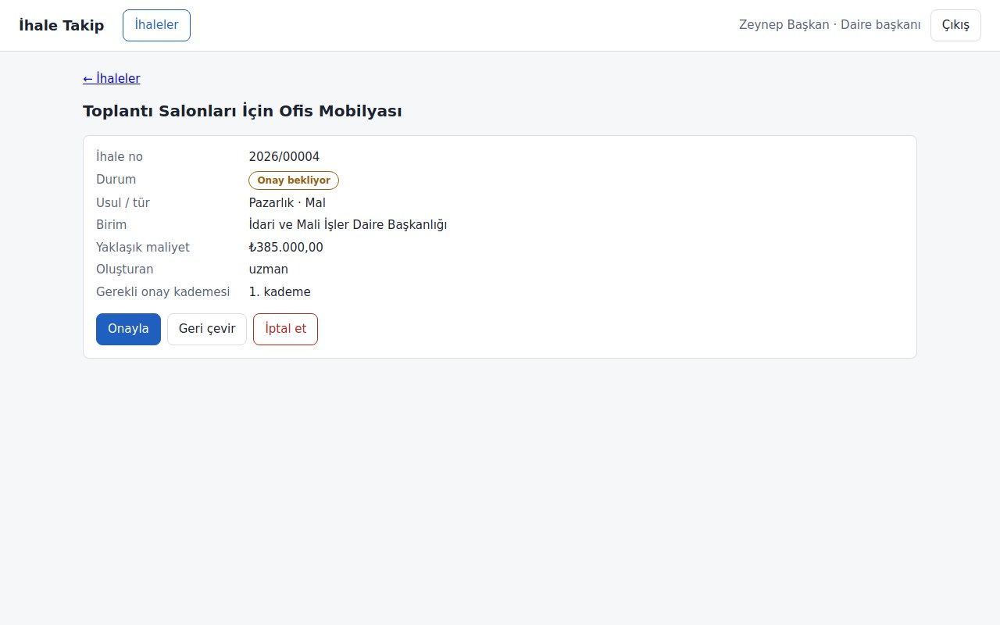 | 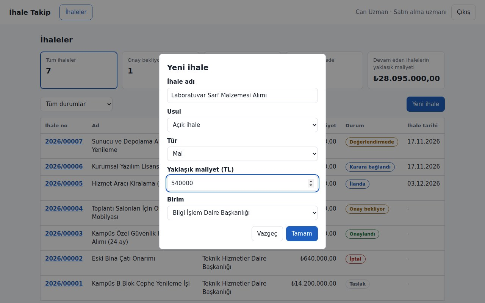 |

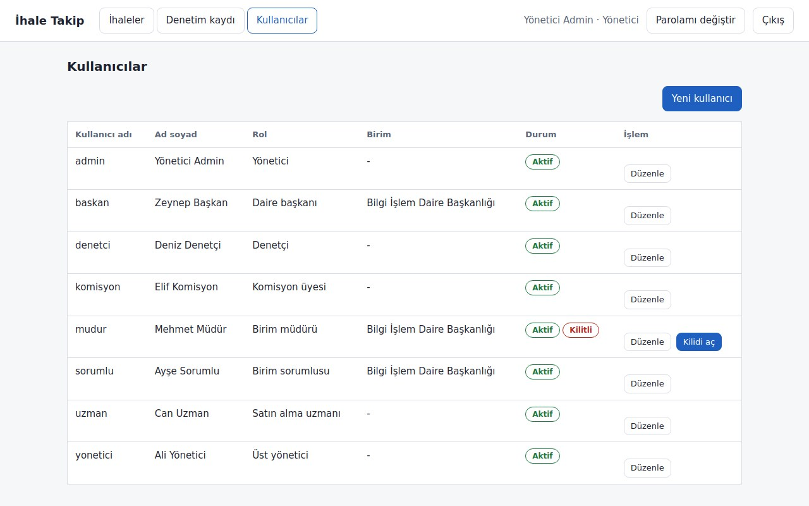

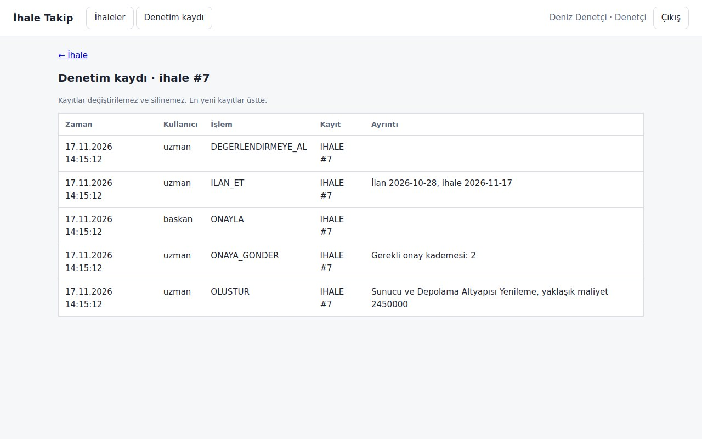

| Yeni kullanıcı | Giriş | Mobil |
|---|---|---|
| 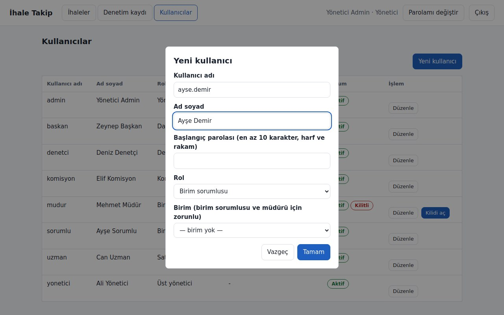 | 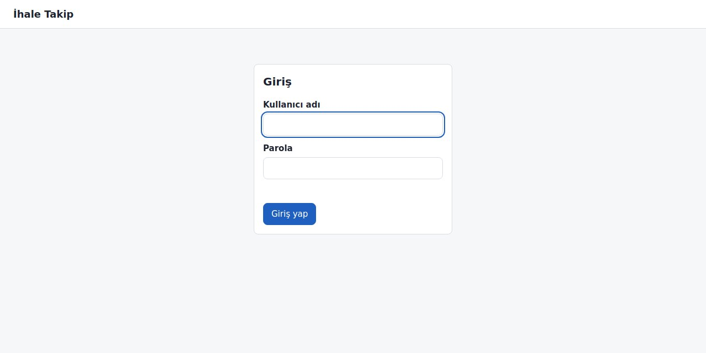 | 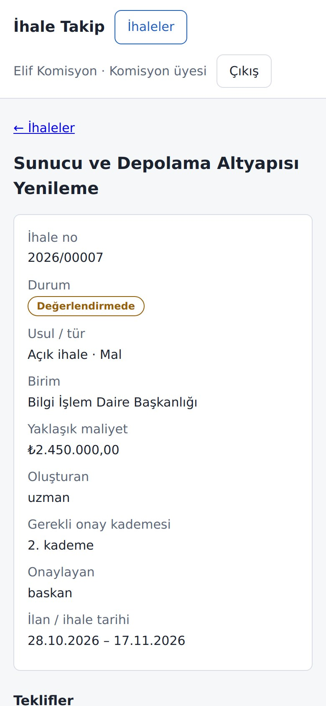 |

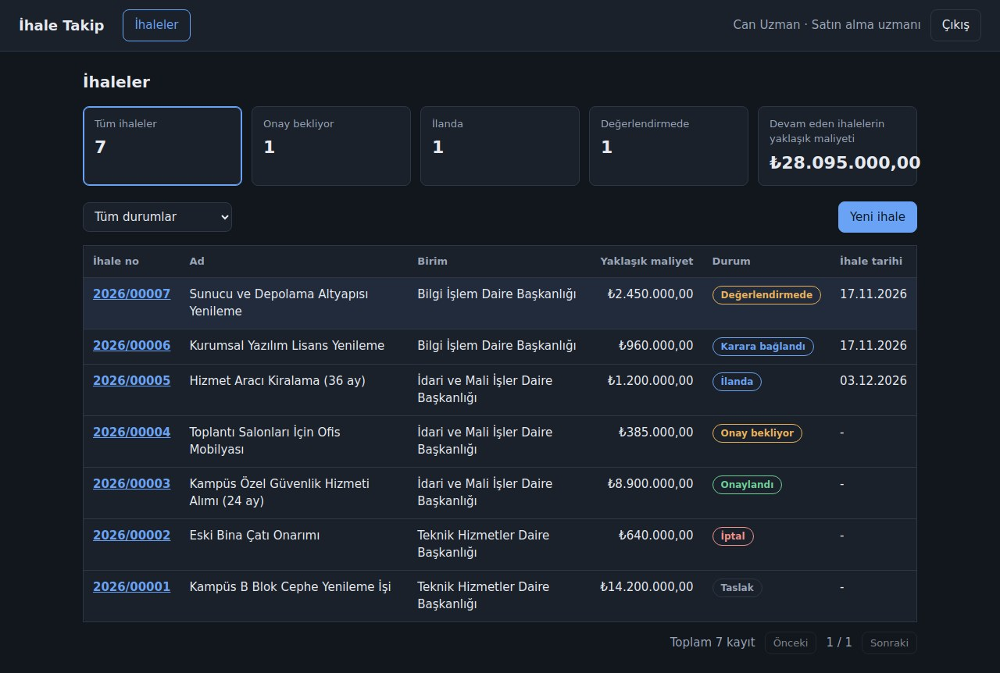

Güvenlik: metinler `textContent` ile yazılır (`innerHTML` yok), sayfa `Content-Security-Policy` ile sunulur ve satır içi betik/stil kullanmaz. Oturum anahtarı `sessionStorage`'da tutulur ve sekme kapanınca silinir.

**Ekran görüntüleri çalışan uygulamadan alınır.** GitHub Actions'taki *Ekran görüntüleri* iş akışı uygulamayı Oracle ile ayağa kaldırır, kurgusal örnek veriyi API üzerinden (tüm iş kurallarından geçirerek) yükler ve tarayıcıdan görüntüleri alır (`tools/ekran-goruntusu`). Görüntülerdeki firma, kişi ve tutarların tümü kurgusaldır.

## API ekran görüntüleri

Swagger arayüzü `/swagger` adresindedir: önce `POST /api/auth/giris` ile anahtar alın, sonra **Authorize** ile girin.

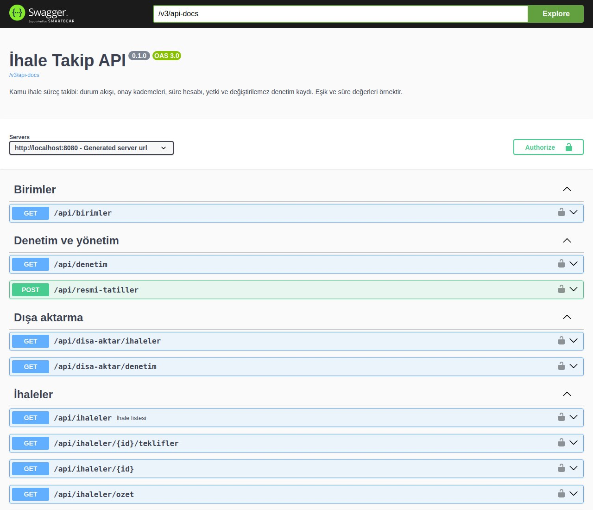

## İş kuralları

```
TASLAK → ONAY_BEKLIYOR → ONAYLANDI → ILANDA → DEGERLENDIRMEDE → KARARLANDI → SOZLESME_IMZALANDI
                ↓ (geri çevir)                                          (her aşamadan IPTAL)
              TASLAK
```

| Kural | Davranış |
| :--- | :--- |
| **Onay kademesi** | Yaklaşık maliyete göre 1/2/3. kademe; ihale, o kademe veya üstü onay seviyesindeki kullanıcı tarafından onaylanır. |
| **Görev ayrılığı** | Kullanıcı kendi oluşturduğu ihaleyi onaylayamaz. Birim müdürü yalnızca kendi birimindeki ihaleyi onaylar. |
| **İlan süresi** | İhale usulüne göre asgari ilan süresi geçmeden ihale tarihi verilemez; ihale tarihi iş günü olmalıdır. |
| **Teklif süresi** | İlan tarihinden önce ve ihale tarihinden sonra teklif alınmaz; aynı istekli aynı ihaleye tek teklif verir. |
| **Aşırı düşük teklif** | Yaklaşık maliyetin ayarlanan oranının altındaki teklif işaretlenir; komisyon açıklamayı kabul veya reddeder. |
| **Karar** | Kazanan, uygun teklifler arasındaki en düşük teklif olmalı ve yaklaşık maliyeti aşmamalıdır. |
| **İtiraz süresi** | Karar tarihinden itibaren süre dolmadan sözleşme imzalanamaz; süre tatile/hafta sonuna denk gelirse sonraki iş gününe uzar. |
| **Eşzamanlılık** | İyimser kilit (`@Version`): aynı ihaleyi iki kişi aynı anda ilerletemez (409). |
| **Hesap güvenliği** | 5 art arda hatalı girişte hesap 15 dakika kilitlenir (ayarlanabilir); parola en az 10 karakter, harf ve rakam içermeli; yönetici kendi hesabını pasife alamaz. |

## Veritabanı şeması

Şema yalnızca Flyway migrasyonlarıyla değişir (`src/main/resources/db/migration`). Denetim tablosunda `BEFORE UPDATE OR DELETE` tetikleyicisi vardır.

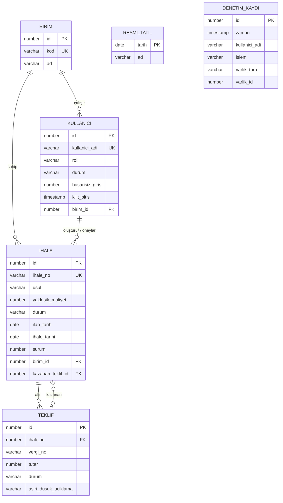

## Mimari

- Katmanlar: `web` (denetleyiciler, DTO'lar) → `servis` (iş akışı, işlem sınırları) → `repo` (Spring Data) → Oracle. İş kuralları `kural/` altında veritabanından bağımsız saf sınıflardır.
- Şema yalnızca Flyway migrasyonlarıyla değişir; Hibernate `ddl-auto: validate` ile şemayı doğrular.
- Mevzuat eşikleri ve süreleri kodda değil yapılandırmadadır (`ihale.kurallar`, `ihale.guvenlik`).
- Hata yanıtları `ProblemDetail` (RFC 9457) biçimindedir; kimlik hatalarında neden sızdırılmaz (kullanıcı yok / parola yanlış / pasif hesap aynı yanıtı verir).
- Oturum JWT ile açılır; rol, birim ve durum her istekte veritabanından okunduğu için yetki değişikliği ve pasife alma hemen etkili olur.
- Denetim kaydı işlemle aynı transaction içinde yazılır; giriş denemesi ve hesap kilidi kendi transaction'ında yazılır (istek hata ile bitse bile sayaç kalıcıdır).
- `ActiveDirectoryLdapAuthenticationProvider` yalnızca `ldap` kipinde kurulur; varsayılan LDAP otomatik yapılandırması kapalıdır.

### Kimlik doğrulama kipleri

- **`yerel` (varsayılan):** Kullanıcı tablosu + BCrypt parola.
- **`ldap`:** Kimlik kurumun Active Directory'sinde doğrulanır; rol ve birim uygulamanın kendi kullanıcı tablosundan gelir. Dizinde olup tabloda kaydı olmayan kullanıcı giremez. Bu kipte parola değiştirme dizinde yapılır.

```bash
KIMLIK_MODU=ldap AD_DOMAIN=kurum.gov.tr LDAP_URL=ldaps://dc.kurum.gov.tr:636
```

## API özeti

Tüm uç noktalar ve istek/yanıt şemaları Swagger'dadır (`/swagger`).

| Yöntem | Yol | Açıklama |
| :--- | :--- | :--- |
| POST | `/api/auth/giris` · `sifre-degistir` | Oturum aç (JWT) / parolayı değiştir |
| GET/POST | `/api/ihaleler` | Listele (sayfalı, `durum` filtreli) / oluştur |
| GET | `/api/ihaleler/ozet` | Durum sayıları ve devam eden ihalelerin toplam maliyeti |
| POST | `/api/ihaleler/{id}/onaya-gonder` · `onayla` · `geri-cevir` | Onay akışı |
| POST | `/api/ihaleler/{id}/ilan` | İlan ve ihale tarihi |
| GET/POST | `/api/ihaleler/{id}/teklifler` | Teklifler |
| POST | `/api/ihaleler/{id}/degerlendirmeye-al` · `karar` · `sozlesme` · `iptal` | Sonraki aşamalar |
| POST | `/api/ihaleler/{id}/teklifler/{tid}/ret` · `asiri-dusuk-aciklama` | Komisyon kararları |
| GET | `/api/kullanicilar` · POST (oluştur) · PUT `/{id}` · POST `/{id}/kilit-ac` | Kullanıcı yönetimi (yönetici) |
| GET | `/api/disa-aktar/ihaleler` · `/denetim` (`?bicim=xlsx\|csv`) | Excel / CSV dışa aktarma |
| GET | `/api/denetim` | Denetim kaydı (denetçi/yönetici/üst yönetici) |
| POST | `/api/resmi-tatiller` | Resmi tatil ekle (dini bayramlar her yıl eklenmelidir) |
| GET | `/api/birimler` | Birim listesi |

## Çalıştırma

Gereken: Docker. Proje köküne `.env` dosyası oluşturun (bu dosya git'e girmez):

```
ORACLE_SYS_SIFRE=<oracle-yonetici-parolasi>
DB_PASSWORD=<uygulama-veritabani-parolasi>
JWT_SECRET=<en-az-32-karakterlik-rastgele-metin>
DEMO_SIFRE=<demo-kullanicilar-icin-parola>
```

```bash
docker compose up --build
```

`dev` profili her rol için bir demo kullanıcı oluşturur (`sorumlu`, `mudur`, `baskan`, `yonetici`, `uzman`, `komisyon`, `denetci`, `admin`); parola `DEMO_SIFRE`'dir. Uygulama `http://localhost:8080` adresinde açılır.

```bash
curl -X POST localhost:8080/api/auth/giris -H "Content-Type: application/json" \
     -d '{"kullaniciAdi":"sorumlu","sifre":"<DEMO_SIFRE>"}'
```

Yapılandırma ortam değişkenleriyle verilir: `DB_URL`, `DB_USER`, `DB_PASSWORD`, `JWT_SECRET`, `KIMLIK_MODU`, `AD_DOMAIN`, `LDAP_URL`. Eşikler ve süreler `application.yml` içindedir.

## Test ve CI

`mvn verify` (Java 21 ve çalışan bir Oracle gerekir; CI bunu bir servis konteyneriyle sağlar).

| Grup | İçerik |
|---|---|
| **Birim testleri** | İş günü ve süre hesabı, onay kademesi sınırları, aşırı düşük teklif sınırları, rol seviyeleri, hesap kilidi mantığı, parola politikası, CSV ve Excel üreticileri (formül enjeksiyonu, biçim, Türkçe karakter) |
| **Entegrasyon: ihale akışı** | Taslaktan sözleşmeye tam akış (saat ileri alınarak), onay kademesi matrisi, geri çevirme, iptal, ilan süresi sınırları, resmi tatil ekleme, teklif kuralları, aşırı düşük teklif kararları, listeleme ve sayfalama, özet |
| **Entegrasyon: kullanıcı yönetimi** | Yetki matrisi, oluşturma ve doğrulama, pasife alma (eski anahtarın geçersiz kalması), kendi hesabını koruma, 5 hatalı girişte kilit, süre dolunca açılma, kilit açma, parola değiştirme, denetim izi |
| **Entegrasyon: dışa aktarma** | CSV ve Excel içeriği, birim kapsamı, yetkiler, denetim kaydına yazılması |
| **Entegrasyon: sözleşme ve sağlık** | Sağlık kontrolü, OpenAPI belgesi, CSP, bozuk/sahte/süresi dolmuş token, girdi doğrulama |

Entegrasyon testleri gerçek Oracle'a ve gerçek güvenlik zincirine karşı çalışır; her test geri alınan bir işlemde yürür ve zaman değiştirilebilir bir saatle ilerletilir. Ayrıca `tools/ekran-goruntusu` iş akışı, uygulamayı Oracle ile gerçekten çalıştırıp tarayıcıdan sürer (bu iş akışı bir hatayı yakaladı: sağlık kontrolü LDAP yüzünden DOWN dönüyordu; artık regresyon testi var).

## Bilinen sınırlar / sonraki adımlar

- **Mevzuat:** eşikler ve süreler örnektir; gerçek kullanımdan önce 4734 sayılı Kanun ile doğrulanmalıdır. Kazanan seçimi yalnızca "en düşük fiyat"; ekonomik olarak en avantajlı teklif ve yaklaşık maliyet hesabı kapsam dışıdır.
- **Resmi tatiller:** yalnızca sabit tarihli tatiller 2026-2027 için yüklüdür; dini bayramlar yönetici tarafından eklenmelidir, aksi halde o günlerdeki süre hesapları yanlış çıkar.
- **Active Directory:** `ldap` kipi kodda var ancak gerçek bir dizine karşı denenmemiştir (CI'da dizin yok).
- **Docker:** `Dockerfile` ve `docker-compose.yml` CI'da derlenmez; CI uygulamayı jar olarak Oracle'a karşı çalıştırır.
- **Kilit yanıtı:** kilitli hesap için 423 dönmesi, hesabın varlığını dışarıya belli eder; çok kullanıcılı gerçek ortamda IP bazlı hız sınırı ek bir katman olarak eklenmelidir.
- **Oturum:** JWT yenileme (refresh) ve çıkışta anahtarı iptal etme yoktur; anahtar 60 dakika geçerlidir.
- **Özet:** durum sayıları bellekte hesaplanır; çok büyük veri kümesinde veritabanı `GROUP BY` sorgusuna çevrilmelidir. Dışa aktarma tek dosyada en çok 10.000 satırdır.
- Belge yükleme, e-imza/EKAP entegrasyonu ve e-posta bildirimi bu sürümde yoktur.

## Lisans

[MIT](LICENSE)
